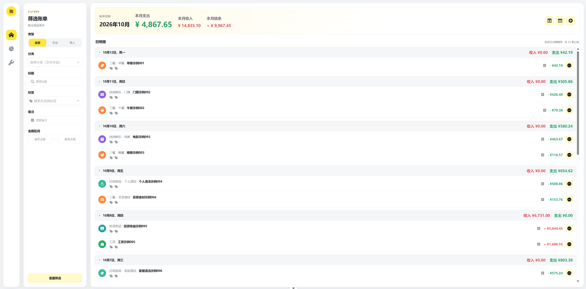
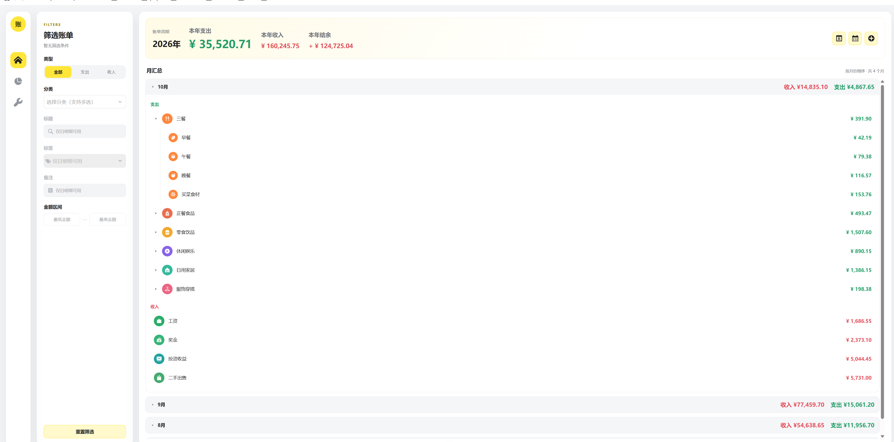
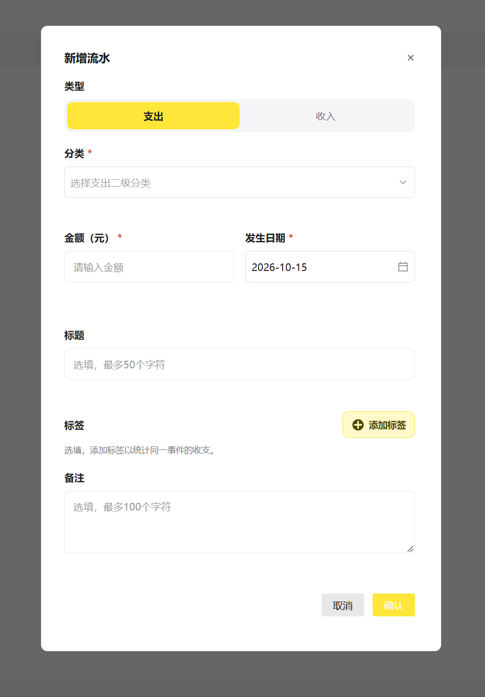
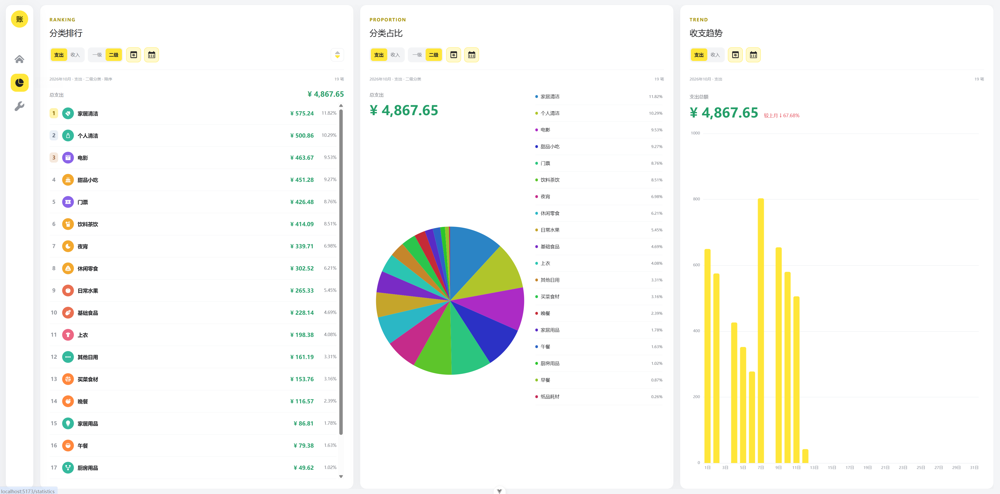
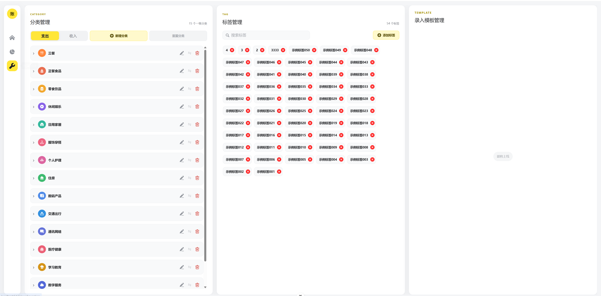

# 00 依据与 Web 设计参考

[返回主 PRD](../PRD.md)

## 1. 需求依据与优先关系

本轮用户要求：编写分模块的原生 iOS PRD，更新根 README 的移动端方向和技术说明；当前不创建工程；界面参考所提供 Web 截图，允许适配移动交互。

2026-10-15 核对的仓库资料：

| 资料 | 用途 |
| --- | --- |
| [根 README](../../README.md) | 项目概况、环境与已实现技术栈 |
| [Flutter 主 PRD](../../app/PRD.md)、[模块文档](../../app/docs/) | 已梳理业务边界与历史移动端方案 |
| [Flutter 实施记录](../../app/docs/11-implementation-report.md) | 确认工程已存在；历史测试记录不是本次原生验证结果 |
| [后端业务设计](../../service-nest/PRD/) | 分类、流水、统计的产品背景 |
| [当前后端源码](../../service-nest/src/modules/) | 路由、DTO、服务方法、归档与统计的最终接口依据 |
| [Web API](../../web/src/api/)、[页面](../../web/src/views/) | 当前请求类型与交互行为 |
| [Web Token](../../web/src/styles/tokens.css)、[分类图标](../../web/src/assets/icons/categories/) | 颜色、圆角、图形及来源许可 |
| 用户提供的五张截图 | 当前浅色视觉与信息层级参考，见下文 |

资料中的历史生成任务、命令和“AI 必须”措辞仅按资料理解，不构成本轮执行授权。源码与旧文档不一致时，以当前实现核对接口；本轮产品取舍在下表显式说明。

## 2. 已识别的差异与取舍

| 发现 | 本轮处理 |
| --- | --- |
| 根 README 曾写 Flutter 工程待初始化，但 `app/` 已有工程和实施记录 | 根 README 标明 Flutter 为已有历史实现，原生 iOS 是后续移动端方向 |
| 根 README 已列 ECharts，但用户希望技术栈更完整 | 保留并具体说明 ECharts 6.1.0、Canvas 按需模块、饼图 / 柱状图和排行列表 |
| 旧 Flutter 统计 PRD 默认一级分类，当前 Web 默认二级 | iOS 默认支出、当前月、二级；收入强制一级，详见统计模块 |
| 历史分类设计 / 方法注释提过联动归档，当前 Service 拒绝删除仍有有效子分类的一级 | iOS 必须先让用户处理二级，不执行自动级联删除 |
| 截图第三张是桌面新增弹窗，长表单尺寸不适合手机 | 改为全屏录入，分类 / 标签用原生子选择页面 |
| Web 三列统计、三列管理及左侧筛选栏 | iOS 用底部导航、统计子分段、管理列表和筛选 Sheet |
| 截图的模板列仅有“即将上线” | 本版不实现模板功能，不以截图占位推断存在接口 |

本版不复用 Flutter 的 Material 3、Riverpod、Dio、fl_chart 或 SVG 运行时加载方式。原生选型见 [01](01-project-foundation.md)，它们是新实现方案，并非已完成安装的依赖清单。

## 3. 原始截图

原图按用户提供顺序保存在本目录的 `references/` 中，不依赖临时剪贴板路径。它们是 Web 参考，后续生成时仍需结合 [08 iOS 交互](08-ios-design-and-interaction.md)，不能直接作为手机页面尺寸规范。

### 图 1：流水日明细

提取：浅灰页面、白卡、黄色选中态、淡黄总览、按日灰底分组、圆形分类图标、支出绿 / 收入红、行尾更多操作。手机保留信息层次，筛选移入面板。

### 图 2：年内月汇总

提取：年度总览、按月折叠、支出分类树与收入分组。手机使用纵向层级列表，金额与层级清晰对齐。

### 图 3：新增流水

提取：收支分段、必填分类 / 金额 / 日期、可选标题 / 标签 / 备注、黄底确认。手机金额优先、单列布局，全屏展示并保护草稿。

### 图 4：收支统计

提取：独立排行、占比、趋势；排行单行无进度条，实心饼图和完整图例，黄色竖向柱状图。手机采用子分段逐个查看，交互从悬停改为触摸选择。

### 图 5：配置管理

提取：收支分类分段、分类树、彩色图标、轻量标签、浅黄添加入口。手机用管理入口进入分类 / 标签独立页面，删除须确认。

## 4. 原生能力参考

以下 Apple 官方资料用于核对选型，具体接口兼容性在后续工程生成时用目标 SDK 验证：

- [Observation / SwiftUI 模型观察](https://developer.apple.com/documentation/swiftui/monitoring-model-data-changes-in-your-app)：iOS 17 及以上采用新的 Observation 方式。
- [Swift Charts 饼图与交互](https://developer.apple.com/videos/play/wwdc2023/10037/)：SectorMark 饼图及触摸选择能力。
- [URLSession ephemeral](https://developer.apple.com/documentation/foundation/urlsessionconfiguration/ephemeral)：会话数据不持久化到磁盘，Cookie 的跨启动保存需另行实现。
- [Keychain Services](https://developer.apple.com/documentation/security/keychain-services)：保存小体积敏感凭据。

这些参考用于说明方案基础，不代表系统组件默认外观已经与 Web 一致，也不代表已验证本项目的 Keychain / Cookie 行为。
