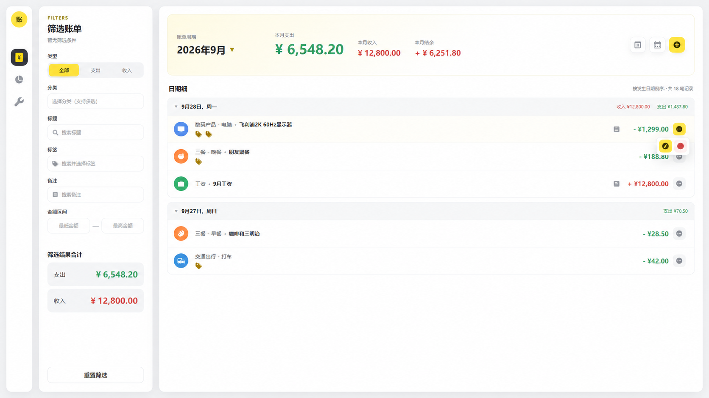
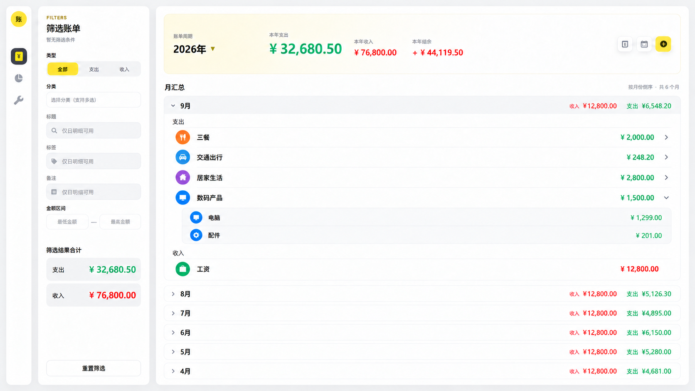

## 流水

一笔支出或收入即为一条流水记录。流水记录必须属于一个用户，并绑定一个符合收支类型和分类层级要求的用户分类；标签不是必填项，一条流水记录可以绑定多个标签。标签用于标记跨多笔流水的同一事件，例如10月1日至7日的新西兰旅行，每笔相关消费都添加“去新西兰旅游”，之后在日明细筛选该标签即可查看相关流水与支出合计。

第一版只记录金额实际发生的日期，不记录具体时分秒。流水记录的发生日期、创建时间和更新时间含义不同：

- `occurred_date` 表示该笔支出或收入实际发生的日期，用于按日、月、年展示和统计账单；
- `created_time` 表示该流水被录入系统的时间；
- `updated_time` 表示该流水最后一次被修改的时间。

## 流水记录表

transactions

| 字段          | 类型与要求                                                              | 说明                                                     |
| ------------- | ----------------------------------------------------------------------- | -------------------------------------------------------- |
| id            | INT AUTO_INCREMENT PRIMARY KEY                                          | 流水记录主键                                             |
| owner_user_id | INT NOT NULL，FK -> users.id，ON DELETE RESTRICT                        | 所属用户id                                               |
| type          | VARCHAR(20) NOT NULL，取值仅限 expense / income                         | 流水类型；expense表示支出，income表示收入                |
| amount        | DECIMAL(15,2) NOT NULL，值必须大于0                                     | 金额绝对值，最多保留两位小数                             |
| category_id   | INT NOT NULL，FK -> user_categories.id，ON DELETE RESTRICT               | 支出绑定二级分类，收入绑定一级分类                       |
| title         | VARCHAR(50) NULL                                                        | 流水标题，用于说明该笔流水的具体内容                     |
| remark        | VARCHAR(100) NULL                                                       | 补充说明，例如优惠、价格异常或其他可能影响后续对账的信息 |
| occurred_date | DATE NOT NULL                                                           | 该笔支出或收入实际发生的日期                             |
| archived_time | DATETIME NULL                                                           | 逻辑删除时间，NULL表示未删除                             |
| created_time  | DATETIME NOT NULL DEFAULT CURRENT_TIMESTAMP                             | 流水录入时间                                             |
| updated_time  | DATETIME NOT NULL DEFAULT CURRENT_TIMESTAMP ON UPDATE CURRENT_TIMESTAMP | 流水最后修改时间                                         |

流水记录表不保存 `tag_id`、分类层级或一级分类id。标签通过 `transaction_tags` 关联表建立多对多关系；分类层级和父分类通过 `category_id` 关联 `user_categories` 表获取，避免同一分类信息在多张表中重复存储并产生不一致。

流水记录表约束：

1. `owner_user_id` 必须取当前登录用户id，不接受客户端指定其他用户。
2. `type` 只能为 `expense` 或 `income`。金额始终以正数保存，收支方向只由 `type` 表达，不使用负数表示支出。
3. `amount` 使用精确定点数保存，必须大于0且最多包含两位小数；小于0、等于0或超过两位小数的金额均不允许保存，不得静默截断或四舍五入。建议建立数据库检查约束 `CHECK (amount > 0)`。
4. 金额在接口中以十进制字符串传输，例如 `"17.28"`；后端不得将金额转换为JavaScript浮点数进行计算，金额汇总和运算必须使用数据库的DECIMAL计算能力或十进制定点数工具。
5. 第一版只支持人民币，不在流水记录表中增加币种字段。
6. `title` 和 `remark` 均为非必填字段。保存前去除首尾空格；去除后为空时统一保存为NULL，不保存空字符串。`title` 最长50个字符，`remark` 最长100个字符。
7. `title` 用于说明该笔流水的具体内容，`remark` 用于记录补充信息。示例：分类为“数码产品 - 电脑”，`title` 为“飞利浦2K 60Hz显示器”，`remark` 为“京东618折扣”。
8. `occurred_date` 是账单查询和统计所使用的业务日期，不能使用 `created_time` 替代。补录历史流水时，`occurred_date` 保存实际发生日期，`created_time` 保存实际录入时间。
9. `category_id` 指向的分类必须属于当前用户，并且分类的 `type` 必须与流水记录的 `type` 一致。支出流水必须绑定 `type = expense` 的二级分类；收入流水必须绑定 `type = income` 的一级分类。
10. 创建流水记录或为已有流水更换分类时，不能选择已经归档的分类。历史流水原先绑定的分类后来被归档时，仍保留原有关联；只修改标题、备注、金额或发生日期时，可以继续保留该已归档分类。
11. 流水记录删除统一采用逻辑删除，只设置 `archived_time`，不物理删除流水。普通流水列表和统计只查询 `archived_time IS NULL` 的记录。
12. 建议建立索引 `INDEX(owner_user_id, type, archived_time, occurred_date, id)` 和 `INDEX(category_id)`，分别用于用户账单的收支及日期查询和分类关联查询。

## 标签表

tags

| 字段          | 类型与要求                                                              | 说明                     |
| ------------- | ----------------------------------------------------------------------- | ------------------------ |
| id            | INT AUTO_INCREMENT PRIMARY KEY                                          | 主键                     |
| owner_user_id | INT NOT NULL，FK -> users.id，ON DELETE RESTRICT                        | 所属用户id               |
| name          | VARCHAR(50) NOT NULL                                                    | 标签名称                 |
| archived_time | DATETIME NULL                                                           | 归档时间，NULL表示未归档 |
| created_time  | DATETIME NOT NULL DEFAULT CURRENT_TIMESTAMP                             | 创建时间                 |
| updated_time  | DATETIME NOT NULL DEFAULT CURRENT_TIMESTAMP ON UPDATE CURRENT_TIMESTAMP | 更新时间                 |

标签表约束：

1. 同一用户未归档的标签名称不能重复，由业务层校验。
2. 已被流水记录引用的标签归档后仍需保留历史关联。
3. 建议建立索引 `INDEX(owner_user_id, archived_time, name)`。
4. 新增或编辑流水时用户可以直接输入标签名称，无需先到配置管理创建。添加或编辑标签时仅查询同名未归档标签，存在时必须先询问用户是否复用；新名称只存入前端草稿，提交流水成功后才持久化。配置管理的新增和改名操作仍直接保存并拒绝同名未归档标签。所有标签名称写入在事务内锁定当前用户，避免并发操作生成重复名称。
5. 删除流水时，如果其绑定的标签没有其他未删除流水引用，则标签随流水一起逻辑删除，设置标签的 `archived_time`，保留标签实体及历史关联。其他未删除流水仍引用的共享标签必须保留；引用判断覆盖当前用户的全部流水，不受账单周期或筛选条件限制。已删除流水保留的历史关联不作为有效引用，连续删除共享标签的流水时，删除最后一条有效引用后才归档该标签。

### 流水标签草稿查重接口

`GET /tags/check-name?name=去新西兰旅游`。用户id从认证上下文取得。名称去除首尾空格后不能为空，最多50个 Unicode 字符。此接口只查询，不创建标签或修改标签名称。

1. 查找当前用户的同名未归档标签，存在时返回 `{ "id": 7, "name": "去新西兰旅游", "archived": false }`，不存在时返回null，响应沿用统一的 `data` 包装。
2. 不复用其他用户或已归档标签。同名匹配沿用标签管理的数据库名称比较规则；一个事件的多笔流水共享同一个未归档标签id。
3. 点击添加或编辑标签弹窗的“确认”后查重。同名时弹出“已经存在同名标签‘{name}’，确认继续使用吗？”，提供“取消”和“继续使用”。取消时保留名称并返回编辑，继续使用才把原标签id纳入草稿；当前流水已经使用该标签时提示“当前流水已添加该标签”，不重复添加。原有已保存标签名称未变时可直接保留，无需再次确认。
4. 添加、编辑或删除标签都只修改当前流水草稿，不显示“标签添加成功”或“标签编辑成功”。取消流水或流水保存失败都不产生独立的标签写入。流水保存成功后才刷新筛选区域的已保存标签选项及配置管理标签列表。
5. 流水提交使用 `tagIds`（保留或已确认复用的已有标签）及 `tagNames`（尚未保存的新名称）。流水、新标签和全部关联必须在同一事务中保存；任一步失败整体回滚。保存时再次查重，若新名称已被并发操作创建，返回409并提示“标签‘{name}’已存在，请重新编辑该标签并确认是否继续使用”，不静默复用；前端保留草稿，用户点击标签后可重新查重确认。
6. 流水中点击标签打开“编辑标签”弹窗并回填名称；编辑只改变当前流水使用的标签，按新名称创建或经确认复用，不重命名其他流水共享的全局标签。全局标签改名仍在配置管理中执行。

## 流水与标签关联表

transaction_tags

| 字段      | 类型与要求                                              | 说明       |
| --------- | ------------------------------------------------------- | ---------- |
| transaction_id | INT NOT NULL，FK -> transactions.id，ON DELETE CASCADE | 流水id     |
| tag_id    | INT NOT NULL，FK -> tags.id，ON DELETE RESTRICT         | 标签id     |

流水与标签关联表约束：

1. 使用 `PRIMARY KEY(transaction_id, tag_id)`，避免一笔流水重复绑定同一个标签，不增加额外的自增id。
2. 建议建立反向查询索引 `INDEX(tag_id, transaction_id)`，用于通过标签筛选流水记录。
3. 流水记录和标签必须属于同一个用户，由业务层校验，不能把其他用户的标签绑定到当前用户的流水记录。
4. 创建流水记录或为已有流水新增、替换标签时，不能选择已经归档的标签。历史流水原先绑定的标签后来被归档时，仍保留原有关联；只修改其他金额字段时，可以继续保留该已归档标签。
5. 流水记录采用逻辑删除时保留其 `transaction_tags` 关联；只有流水记录被物理删除时，才通过 `ON DELETE CASCADE` 删除对应关联记录。
6. 流水记录及其标签关联的创建或修改必须在同一个数据库事务中完成，避免只保存流水记录或只保存部分标签关联。

## 跨表业务约束

1. 流水记录、分类和标签必须属于同一个用户。默认分类模板不直接关联流水记录。
2. `transactions.type` 与 `user_categories.type` 必须一致，且分类层级必须符合支出绑定二级分类、收入绑定一级分类的规则。
3. 流水记录不冗余保存分类层级和一级分类id。按支出一级分类筛选时，通过 `transactions.category_id` 关联二级分类，再使用 `user_categories.parent_id` 查询其一级分类；按二级分类或收入一级分类筛选时，直接使用 `transactions.category_id`。
4. 通过标签筛选流水记录时，使用 `transaction_tags.tag_id` 关联 `transactions.id` 完成查询，不在流水记录表中保存单个标签id。

## 后端业务逻辑

### 流水模块

流水模块目录命名为 `transactions`。第一版对外提供日明细查询、月汇总查询、创建流水、编辑流水和删除流水共五个接口。日明细和月汇总的查询范围、聚合方式及列表分组结构不同，因此拆分为两个查询接口；两个接口共用 `period`、`totals`、`filterTotals` 外层响应字段，分别扩展 `days` 和 `months`。

统一身份和数据约束：

1. 下列所有业务方法中的 `userId` 均表示当前登录用户id，由Controller从JWT等登录凭证解析后的认证上下文中取得，再传给Service。
2. `userId` 不作为路径参数、查询参数或请求体字段由客户端提交。所有流水记录、分类和标签查询都必须同时校验 `owner_user_id = userId`，不能只依赖客户端提交的流水id、分类id或标签id。
3. 金额在请求和响应中统一使用十进制字符串，例如 `"17.28"`。后端负责校验格式并使用精确定点数进行比较、汇总和计算，不使用JavaScript浮点数直接计算金额。
4. 普通查询只返回 `transactions.archived_time IS NULL` 的流水记录；流水关联的分类或标签后来被归档时，查询历史流水仍需返回其名称、图标及关联信息。
5. 第一版的日明细查询范围固定为一个自然月，月汇总查询范围固定为一个自然年，两者均不分页。没有流水记录的日期或月份不生成空分组。

| 业务操作 | Service方法 | HTTP接口 | 说明 |
| --- | --- | --- | --- |
| 查询日明细 | `findDailyTransactions(userId, month, ...筛选参数)` | `GET /transactions/daily` | 返回整月总览、筛选结果合计和筛选后的日明细 |
| 查询月汇总 | `findMonthlySummary(userId, year, type?, categoryIds?, minAmount?, maxAmount?)` | `GET /transactions/monthly-summary` | 返回整年总览、筛选结果合计和月分类汇总，不支持标题、标签、备注筛选 |
| 创建流水 | `create(userId, dto)` | `POST /transactions` | 创建一条流水记录及其标签关联 |
| 编辑流水 | `update(userId, transactionId, dto)` | `PATCH /transactions/:id` | 编辑除流水类型以外的全部金额字段 |
| 删除流水 | `archive(userId, transactionId)` | `DELETE /transactions/:id/archive` | 逻辑删除流水及没有其他有效引用的标签，保留历史关联 |

### 查询流水

#### 筛选条件与模式适用范围

两个查询接口共用类型、分类和金额区间筛选。标题、标签、备注只适用于按月查询的日明细；按年查询的月汇总不支持这三项筛选，前端保留控件位置但置为禁用。两种模式都按各自时间范围统计当前用户的未删除流水。

| 字段 | 是否必填 | 日明细（月周期） | 月汇总（年周期） | 说明 |
| --- | --- | --- | --- | --- |
| `type` | 否 | 支持 | 支持 | `expense` 或 `income`；不传表示同时查询支出和收入 |
| `categoryIds` | 否 | 支持 | 支持 | 分类id数组，允许同时选择多个一级或二级分类，同一筛选项之间按“任意匹配”处理 |
| `tagIds` | 否 | 支持 | 不支持，控件禁用 | 标签id数组，一条流水包含任意一个所选标签即视为匹配 |
| `title` | 否 | 支持 | 不支持，控件禁用 | 标题包含搜索，去除首尾空格后最长50个字符 |
| `remark` | 否 | 支持 | 不支持，控件禁用 | 备注包含搜索，去除首尾空格后最长100个字符 |
| `minAmount` | 否 | 支持 | 支持 | 最小金额，使用最多两位小数的十进制字符串，包含边界值 |
| `maxAmount` | 否 | 支持 | 支持 | 最大金额，使用最多两位小数的十进制字符串，包含边界值 |

公共筛选规则：

1. `type` 不传时表示“全部”；不使用空字符串表达全部。
2. `categoryIds` 和 `tagIds` 中的重复id先去重。客户端提交的每个分类和标签都必须属于当前用户；指定 `type` 时，所选分类必须与该类型一致，否则请求校验失败。用于查询时允许 `categoryIds` 和 `tagIds` 包含当前用户已归档分类或标签的id，以便筛选历史流水。
3. 支出一级分类作为筛选条件时，匹配该一级分类下所有二级分类的流水记录；支出二级分类和收入一级分类直接通过 `transactions.category_id` 匹配。多个分类之间使用“或”关系。
4. 日明细查询支持多个标签之间使用“或”关系，即流水记录包含任意一个所选标签即可返回。标签筛选使用 `transaction_tags` 关联查询，不先查询流水id再发起第二次流水查询；月汇总查询不接受或应用标签筛选。
5. 日明细查询的 `title` 和 `remark` 分别执行包含搜索。后端必须转义 `%`、`_` 等LIKE通配字符，避免用户输入改变搜索语义；月汇总查询不接受或应用标题、备注筛选。
6. `minAmount` 和 `maxAmount` 可以单独使用或同时使用；同时存在时必须满足 `minAmount <= maxAmount`。
7. 顶部周期总览与列表筛选采用不同统计口径：顶部总支出、总收入和结余只统计当前用户在所选月份或年份内的未删除流水，不受 `type`、`categoryIds`、`tagIds`、`title`、`remark`、`minAmount`、`maxAmount` 影响；结余固定按照“收入合计 - 支出合计”计算。筛选区域的支出、收入合计与当前列表使用完全相同的时间范围和全部筛选条件，不统计结余。
8. 所有汇总金额和流水金额均以两位小数的十进制字符串返回。

#### 查询结果与统计口径

两个查询接口都在同一次响应中返回周期总览、筛选结果合计和列表数据，不新增单独的公开统计接口。Controller 使用DTO校验请求，Service 接收 `userId`、`month` 或 `year` 及各个具体筛选参数，不直接以查询DTO作为Service参数。

1. `totals` 表示顶部周期总览，包含 `expense`、`income`、`balance`。查询日明细时统计所选完整自然月，查询月汇总时统计所选完整自然年；筛选类型为支出或收入时，仍返回周期内完整的收入、支出和结余。
2. `filterTotals` 表示筛选区域的只读合计，仅包含 `expense`、`income`，不包含 `balance`。这两个值与当前列表、日期分组及月份分类汇总采用当前模式支持的完全相同的筛选条件；年周期只应用类型、分类和金额区间，不应用标题、标签或备注。
3. `type = expense` 时 `filterTotals.income` 为 `"0.00"`；`type = income` 时 `filterTotals.expense` 为 `"0.00"`。两个字段始终返回；没有匹配记录时均返回 `"0.00"`。未设置其他筛选且类型为全部时，筛选合计与周期总览的对应收支金额相同。
4. 顶部周期总览必须独立于筛选后的列表统计，不得从筛选后的 `days`、`months` 或流水数组推导。建议将列表查询、周期总览统计和筛选合计统计拆分为内部方法；通过共享基础条件和筛选条件构造逻辑避免口径不一致，不复制多套筛选规则。日明细与月汇总共用周期总览统计方法，其参数只需要 `userId`、`startDate`、`endDate`。
5. 所有查询必须限定 `owner_user_id = userId`、`transactions.archived_time IS NULL`，并以实际发生日期过滤。月份转换为当月1日至下月1日，年份转换为当年1月1日至次年1月1日；使用 `>= startDate AND < endDate` 的左闭右开范围。
6. 统计按流水的 `type` 分别求支出和收入合计，不直接把全部正数金额相加作为支出、收入或结余。金额使用数据库DECIMAL或十进制定点数工具计算，空合计转换为 `"0.00"`，所有金额按两位小数的十进制字符串返回。
7. 金额统计不能直接对流水与多标签JOIN后的重复行求和。日明细的标签筛选采用 `EXISTS` 等不会重复流水的方式，列表可以另外关联并返回完整标签；年周期无需为标签筛选或展示关联标签表。不能使用 `SUM(DISTINCT amount)` 代替按流水去重，否则不同流水金额相同时会被错误合并。
8. 筛选结果合计可以独立查询，也可以根据已经获取的完整、去重后的筛选流水或分类汇总使用精确定点数计算；它不强制占用一条单独SQL，但必须与列表一致，且不得使用JavaScript浮点数直接求和。同一次响应的列表和统计应基于一致的数据快照；多SQL查询时应保证并发修改不会造成同一响应内的数值矛盾。
9. 当前周期存在流水但筛选无匹配记录时，`totals` 仍保留完整周期总览，`filterTotals` 两项为 `"0.00"`，列表分组为空；只有当前周期完全没有未删除流水时，两种统计才同时为零。

例如：所选月份为2026-09，整月支出为 `"6548.20"`、收入为 `"12800.00"`、结余为 `"6251.80"`。筛选餐饮且匹配支出为 `"1500.00"` 时，`totals` 保持不变，`filterTotals` 为 `{ "expense": "1500.00", "income": "0.00" }`，列表仅返回匹配流水。

#### 公共查询响应结构

日明细和月汇总的外层公共字段提取为 `TransactionPeriodSummary` 接口，供两种响应类型继承，统一周期和统计字段的定义，便于前端共用周期展示、顶部总览及筛选结果合计逻辑。接口统一使用PascalCase命名，名称体现流水领域、查询周期和汇总职责。

`period` 表示本次查询的完整周期，统一使用字符串；它表示查询范围，不表示列表的分组单位。日明细按月查询时返回 `YYYY-MM`，例如 `"2026-09"`；月汇总按年查询时返回 `YYYY`，例如 `"2026"`。即使没有匹配记录，也必须返回所查询的 `period`。

```typescript
export interface TransactionPeriodSummary {
  period: string;
  totals: {
    expense: string;
    income: string;
    balance: string;
  };
  filterTotals: {
    expense: string;
    income: string;
  };
}

export interface DailyTransactionsResult extends TransactionPeriodSummary {
  days: DailyTransactionGroup[];
}

export interface MonthlySummaryResult extends TransactionPeriodSummary {
  months: MonthlySummaryGroup[];
}
```

其中 `DailyTransactionGroup` 表示日期分组及其流水明细，`MonthlySummaryGroup` 表示月份分组及其分类汇总，字段分别遵循下文两个接口的响应要求。`days` 和 `months` 由各自响应类型定义为必填数组，公共接口只包含两种模式共有的字段。

请求参数仍由两个接口分别使用 `month` 和 `year`，Controller 的查询DTO及Service参数保持对应的周期含义；响应统一将所查询的 `month` 或 `year` 作为字符串返回到 `period`。月汇总响应不再使用顶层 `year` 字段。

#### 公共分组合计结构

日期分组和月份分组的 `expenseTotal`、`incomeTotal` 都表示该分组内匹配全部筛选条件的收支合计，提取为 `TransactionGroupTotals` 接口，由 `DailyTransactionGroup` 和 `MonthlySummaryGroup` 继承。

```typescript
export interface TransactionGroupTotals {
  expenseTotal: string;
  incomeTotal: string;
}

export interface DailyTransactionGroup extends TransactionGroupTotals {
  date: string;
  transactions: DailyTransactionItem[];
}

export interface MonthlySummaryGroup extends TransactionGroupTotals {
  month: number;
  expenseCategories: ExpenseCategorySummary[];
  incomeCategories: IncomeCategorySummary[];
}
```

`DailyTransactionItem` 表示下文日明细接口中的单条流水。`ExpenseCategorySummary` 表示支出一级分类汇总及其二级分类 `children`；`IncomeCategorySummary` 表示收入一级分类汇总，不包含 `children`。分类汇总的具体字段遵循下文月汇总接口的响应要求。

分组标识保留在各自接口中：日分组的 `date` 为 `YYYY-MM-DD` 字符串，月分组的 `month` 为1至12的整数，与外层 `period` 所表示的年份共同确定月份。两者含义和类型不同，不纳入公共分组合计接口，也不改为共用的 `period` 字段。

`TransactionPeriodSummary` 描述整个查询周期及两种统计口径，`TransactionGroupTotals` 描述一个日期或月份分组的筛选合计，二者职责不同。分组合计始终使用当前列表的筛选条件，不能用未筛选的外层 `totals` 替代。

上述两个公共接口用于复用TypeScript类型定义，JSON响应保持现有嵌套结构：外层直接返回 `period`、`totals`、`filterTotals`，分组直接返回 `expenseTotal`、`incomeTotal` 及各自的分组标识和列表字段。

#### 查询日明细

`GET /transactions/daily` 额外接收必填参数 `month`，格式为 `YYYY-MM`，表示查询一个自然月。系统初始进入账单列表页时查询当前月份。

响应要求：

1. 返回所查询月份的 `period`（`YYYY-MM` 字符串）、当前完整月份的周期总览 `totals`、应用全部筛选条件的合计 `filterTotals` 和按发生日期分组的筛选流水；日期按照 `occurred_date DESC` 排序，最新日期位于最上方。
2. 同一天内的流水按照 `created_time DESC, id DESC` 排序，使后录入的流水优先展示。
3. 每个日期分组返回日期、当日支出合计、当日收入合计和流水数组；当日合计只统计匹配全部筛选条件的流水，各日支出和收入合计之和分别等于 `filterTotals.expense` 和 `filterTotals.income`。星期不存入数据库，也不要求作为独立持久化字段，由前端根据日期计算并本地化展示。
4. 每条流水记录至少返回 `id`、`type`、`amount`、`title`、`remark`、`occurredDate`、分类信息和标签数组。
5. 支出分类信息同时返回一级分类和实际绑定的二级分类，包括各自的id、名称、`iconKey`、最终渲染颜色和归档状态；收入只返回实际绑定的一级分类。
6. 标签数组返回标签id、名称和归档状态。流水记录没有标签时返回空数组，不返回NULL。
7. 流水关联的分类或标签已经归档时仍正常返回，用于完整展示历史数据；归档状态不得导致历史流水记录查询失败。
8. 没有匹配流水的日期不返回。整月没有匹配记录时，`filterTotals` 两项为 `"0.00"`，`days` 为空数组，`totals` 仍返回整月未删除流水的总览；整月完全没有未删除流水时，`totals` 三项也为 `"0.00"`。

响应结构示意：

以下示意展示未筛选、类型为全部的状态，仅列出部分列表内容；实际响应必须返回全部匹配分组，并满足上述合计一致性要求。

```jsonc
{
  "period": "2026-09",
  "totals": {
    "expense": "6548.20",
    "income": "12800.00",
    "balance": "6251.80"
  },
  "filterTotals": {
    "expense": "6548.20",
    "income": "12800.00"
  },
  "days": [
    {
      "date": "2026-09-28",
      "expenseTotal": "1346.80",
      "incomeTotal": "0.00",
      "transactions": [
        {
          "id": 1,
          "type": "expense",
          "amount": "1299.00",
          "title": "飞利浦2K 60Hz显示器",
          "remark": "京东618折扣",
          "occurredDate": "2026-09-28",
          "category": {
            "primary": {
              "id": 1,
              "name": "数码产品"
            },
            "secondary": {
              "id": 2,
              "name": "电脑",
              "iconKey": "icon-expense-digital-computer",
              "backgroundColor": "#6D7CE8"
            }
          },
          "tags": [
            {
              "id": 1,
              "name": "办公设备"
            }
          ]
        }
      ]
    }
  ]
}
```

#### 查询月汇总

`GET /transactions/monthly-summary` 接收必填参数 `year`，格式为四位年份 `YYYY`，表示查询一个自然年；可选筛选参数仅为 `type`、`categoryIds`、`minAmount`、`maxAmount`。

`title`、`tagIds`、`remark` 不属于年查询接口的合法参数。请求中出现任一字段时（包括空字符串或空数组）返回400参数校验错误，提示“年周期不支持标题、标签或备注筛选”；前端须完全省略这三个字段，而不是以空值提交。后端年查询方法只接收支持的具体参数，不添加这三项筛选谓词；即使复用公共查询构造逻辑，也不得将旧的日明细筛选值带入年查询。

响应要求：

1. 返回所查询年份的 `period`（`YYYY` 字符串）、当前完整年份的周期总览 `totals`、应用全部筛选条件的合计 `filterTotals` 和按月份分组的筛选分类汇总；月份按照倒序排列，最新且有匹配数据的月份位于最上方。
2. 每个月份返回匹配全部筛选条件的该月支出合计、收入合计、支出分类汇总和收入分类汇总；各月支出和收入合计之和分别等于 `filterTotals.expense` 和 `filterTotals.income`。没有匹配流水的月份不返回。
3. 支出先按一级分类汇总，再在一级分类下按二级分类汇总。一级分类金额等于其全部匹配二级分类金额之和。
4. 收入只按一级分类汇总，不返回二级分类数组。
5. 一级分类和二级分类都按照用户分类的 `sort_order, id` 排序，不按照金额大小重新排序。
6. 分类汇总返回分类id、名称、`iconKey`、最终渲染颜色、归档状态和汇总金额。历史流水引用的已归档分类仍参与汇总并正常返回。
7. 月汇总不返回单笔流水的标签、标题和备注，也不支持这三项筛选。`filterTotals` 与月份分类汇总仅应用时间、类型、分类和金额区间条件；顶部 `totals` 始终统计整个所选年份，不受任何可选筛选条件影响。
8. 整年没有匹配记录时，`filterTotals` 两项为 `"0.00"`，`months` 为空数组，`totals` 仍返回整年未删除流水的总览；整年完全没有未删除流水时，`totals` 三项也为 `"0.00"`。

响应结构示意：

以下示意展示未筛选、类型为全部的状态，仅列出部分列表内容；实际响应必须返回全部匹配分组，并满足上述合计一致性要求。

```jsonc
{
  "period": "2026",
  "totals": {
    "expense": "32680.50",
    "income": "76800.00",
    "balance": "44119.50"
  },
  "filterTotals": {
    "expense": "32680.50",
    "income": "76800.00"
  },
  "months": [
    {
      "month": 9,
      "expenseTotal": "6548.20",
      "incomeTotal": "12800.00",
      "expenseCategories": [
        {
          "id": 1,
          "name": "数码产品",
          "amount": "1299.00",
          "children": [
            {
              "id": 2,
              "name": "电脑",
              "amount": "1299.00"
            }
          ]
        }
      ],
      "incomeCategories": [
        {
          "id": 3,
          "name": "工资",
          "amount": "12800.00"
        }
      ]
    }
  ]
}
```

### 创建流水

`POST /transactions` 请求体字段：

| 字段 | 是否必填 | 说明 |
| --- | --- | --- |
| `type` | 是 | `expense` 或 `income`，默认值由前端提供，后端不依赖默认值补全 |
| `categoryId` | 是 | 支出二级分类id或收入一级分类id |
| `amount` | 是 | 大于0且最多两位小数的十进制字符串 |
| `occurredDate` | 是 | 实际发生日期，格式为 `YYYY-MM-DD` |
| `title` | 否 | 标题，去除首尾空格后最长50个字符 |
| `tagIds` | 否 | 已有标签id数组；不传或空数组表示不绑定已有标签，与tagNames合起来构成完整标签集合 |
| `tagNames` | 否 | 新标签名称草稿数组，每项去除首尾空格后为1至50个Unicode字符；与已有标签id共同构成标签集合 |
| `tagUpdates` | 否 | 已有标签改名草稿数组，每项包含正整数 `id` 和规范化后1至50个Unicode字符的 `name`；id必须属于 `tagIds` |
| `remark` | 否 | 备注，去除首尾空格后最长100个字符 |

业务要求：

1. 客户端不提交流水id、所属用户、归档时间、创建时间或更新时间，`owner_user_id` 必须取认证上下文中的 `userId`。
2. `amount` 必须按照流水表约束校验并以DECIMAL精确保存，不能接收负数、0、超过两位小数或超出字段范围的值。
3. `occurredDate` 必须是有效的自然日期。第一版只记录日期，不保存星期或具体时分秒。
4. `title` 和 `remark` 去除首尾空格后为空时保存为NULL；未提供时同样保存为NULL。
5. 分类必须属于当前用户且未归档。支出必须选择支出二级分类，收入必须选择收入一级分类，分类类型必须与 `type` 一致。
6. `tagIds` 先去重；每个标签都必须属于当前用户且未归档。`tagNames` 表示尚未保存的新名称，先规范化去重并再次校验同名标签，不能自动复用未经用户确认的标签。两种数组都为空时不绑定标签。
7. 流水记录、新标签、已有标签改名和全部 `transaction_tags` 关联必须在同一个数据库事务中保存，任何一步失败都必须回滚。`tagUpdates` 保留标签原id，只修改名称；同一标签的其他流水引用同步展示新名称，不创建替代标签。改名须校验用户归属、完整标签集合及未归档标签的名称唯一性。
8. 创建成功后不返回流水记录数据，由前端按照当前展示形式和筛选条件重新查询列表、顶部周期总览及筛选结果合计。

### 编辑流水

`PATCH /transactions/:id` 的路径参数 `id` 为必填整数。请求体完整提交 `categoryId`、`amount`、`occurredDate`、`title`、`tagIds` 和 `remark`，存在新名称草稿时提交 `tagNames`，已有标签改名时提交 `tagUpdates`（每项包含原 `id` 和新 `name`），不提交也不允许修改 `type`。

业务要求：

1. 只允许编辑当前用户自己的未删除流水记录；记录不存在、已删除或属于其他用户时统一按“流水记录不存在”处理，避免越权读取。
2. 流水记录的 `type` 创建后不可编辑。新的分类必须符合该记录原有类型及分类层级要求。
3. `amount`、`occurredDate`、`title` 和 `remark` 的校验及标准化规则与创建流水一致。
4. 如果 `categoryId` 与原分类不同，新分类必须属于当前用户且未归档；如果分类id未改变，则允许保留后来已经归档的原分类。
5. `tagIds` 与 `tagNames` 合起来表示编辑后的完整标签集合。原流水已经绑定且后来归档的标签允许继续保留或移除，但不能新绑定其他已归档标签；所有新增标签必须属于当前用户且未归档。修改已有标签名称时保留原标签id，通过 `tagUpdates` 对原标签改名，所有引用该标签的流水同步展示新名称，不新增标签或替换关联。改名id必须属于本次完整标签集合且不能重复，名称与其他未归档标签冲突时拒绝提交。
6. 新标签创建、已有标签改名、更新流水记录和替换标签关联必须在同一个数据库事务中完成，失败时整体回滚。标签关联更新根据新旧id集合计算新增和删除项，单纯改名不改写原关联。标签名称写入与配置管理共用用户级锁，避免并发产生重名。
7. 执行更新时必须再次限定流水id、`owner_user_id = userId` 和 `archived_time IS NULL`；实际更新行数必须恰好为1，否则按编辑失败处理。
8. 编辑成功后不返回流水记录数据，由前端按照当前展示形式和筛选条件重新查询列表、顶部周期总览及筛选结果合计。

### 删除流水

`DELETE /transactions/:id/archive` 的路径参数 `id` 为必填整数，请求体为空。

业务要求：

1. 删除统一执行逻辑删除，只设置 `archived_time`，不物理删除流水记录，也不删除其 `transaction_tags` 历史关联。
2. 只允许删除当前用户自己的未删除流水记录；记录不存在、已删除或属于其他用户时统一按“流水记录不存在”处理。重复删除同一记录不会重复更新。
3. 执行删除时必须同时限定流水id、`owner_user_id = userId` 和 `archived_time IS NULL`；实际更新行数必须恰好为1，否则按删除失败处理。
4. 删除流水后，检查该流水绑定的当前用户未归档标签。如果标签没有其他未删除流水引用，则同时设置标签的 `archived_time`；存在其他有效引用时保留标签。引用检查必须通过 `transaction_tags` 关联全部周期内 `owner_user_id = userId` 且 `archived_time IS NULL` 的流水，不受当前月份、年份或筛选条件限制。已删除流水保留的历史关联不计入有效引用；没有标签时只删除流水，已经归档的标签不重复更新。
5. 流水删除、标签引用检查及独占标签归档必须在同一个数据库事务中完成，任一步失败整体回滚。归档标签时再次限定标签id、用户归属及未归档状态，并校验实际更新数量。与标签创建、改名使用一致的用户级锁顺序，并锁定待检查的标签，避免并发绑定或删除共享标签时误归档。
6. 删除成功后不返回流水记录数据，由前端重新查询当前列表、顶部周期总览、筛选结果合计及标签筛选选项，保留当前展示形式、账单周期和筛选条件。

## 前端交互逻辑

### 账单列表页面

#### 页面布局

1. 页面沿用项目现有的灰色页面背景、白色卡片、黄色主题色、圆角和阴影规范，并使用现有固定侧边导航。
2. 主内容区横向排列筛选卡片和账单数据卡片。筛选卡片使用固定宽度，账单数据卡片占据剩余宽度；两张卡片之间保留统一页面间距。
3. 两张卡片占满浏览器视口扣除页面间距后的可用高度，页面本身不出现纵向滚动条。筛选条件或账单内容超过可用高度时，只在各自卡片的内容区滚动。
4. 筛选卡片在金额区间下方、底部“重置”按钮上方按筛选条件展示“筛选结果合计”区域；包含只读支出和收入两个字段，没有筛选条件时整个区域隐藏。重置按钮继续固定在底部；重置只清空类型、分类、标题、标签、备注和金额条件，不改变日明细/月汇总模式及当前所选月份或年份。
5. 账单数据卡片由顶部汇总操作区和账单列表区组成。顶部区域固定展示，列表内容在剩余空间内独立滚动。
6. 页面业务图标统一使用 `//at.alicdn.com/t/c/font_5236708_e5t8yze3f9f.js` 中的图标；分类图标继续使用项目本地分类图标资源及其最终渲染颜色。
7. 通用Iconfont图标由主题和操作语义着色：搜索与备注保持图标灰，标签使用深黄色；日历、日明细/月汇总切换、新增、更多和编辑图标默认使用深色，删除图标 `icon-shanchu1` 使用警告红色 `#ff2525` 并保留内部白色减号。分类图标保留自身图案及背景色。
8. 重置筛选、日历、日明细/月汇总切换、新增、更多、编辑、删除按钮默认背景统一为 `#fff9cc`，悬停或键盘聚焦时为主题色 `#ffe639`，普通操作图标保持深色，删除图标保持警告红色；禁用按钮不执行操作。侧边导航选中项的图标背景为 `#ffe639`，悬停时为 `#fff9cc`。

#### 展示形式和日期选择

1. 页面提供“日明细”和“月汇总”两种展示形式，默认使用日明细并查询当前月份。
2. 日明细按一个自然月查询，并以发生日期为分组单位展示具体流水记录；月汇总按一个自然年查询，并以月份为分组单位展示分类汇总。
3. 展示形式切换按钮只展示图标：日明细状态下展示月报图标 `icon-tianjinshiliangyoujiagezhishuyuebao`，表示点击后切换到月汇总；月汇总状态下展示日报图标 `icon-ribao`，表示点击后切换到日明细。
4. 切换按钮必须提供“切换到月汇总”或“切换到日明细”的Tooltip、`aria-label` 和键盘操作能力，避免图标含义不清。
5. 日明细使用单个月份选择器，显示格式为“YYYY年M月”；月汇总使用单个年份选择器，显示格式为“YYYY年”。两者共用日历图标 `icon-rili` 作为入口。
6. 从日明细切换到月汇总时，默认使用当前月份所属年份；从月汇总切换到日明细时，如果所选年份是当前年份则使用当前月份，否则默认使用该年份的12月。
7. 日期和月份分组均按照倒序展示，最新日期或最新月份位于最上方。
8. 从日明细切换到月汇总时，先取消标题、标签、备注相关的待执行防抖任务，并清空 `title`、`tagIds`、`remark`；禁用这三个筛选控件后再发起年查询。类型、分类、金额区间保留，并继续参与年查询；较早的日明细请求响应不得覆盖年模式。
9. 从月汇总切回日明细时，重新启用标题、标签和备注控件，三个值保持清空，不自动恢复之前已清除的日明细筛选；其他仍有效的筛选条件继续保留。

#### 顶部汇总和操作区

1. 左侧突出展示当前周期、总支出、总收入和结余；周期读取响应的 `period`，根据当前展示形式将 `YYYY-MM` 或 `YYYY` 格式化为月份或年份文案。日明细使用“本月”文案，月汇总使用“本年”文案。
2. 支出金额使用绿色，收入金额使用红色；支出作为默认关注指标时使用较大字号和较粗字重。
3. 结余按照“收入 - 支出”展示。正结余使用红色并带 `+`，负结余使用绿色并带 `-`，零结余显示 `0.00` 并使用中性灰色。
4. 顶部使用接口的 `totals`，只反映当前所选月份或年份的整体收支，不随左侧类型、分类、标题、标签、备注或金额筛选变化。保持现有顶部布局，始终展示支出、收入、结余三项；即使筛选类型为“支出”或“收入”，也不隐藏其他顶部指标。文案继续使用“本月支出 / 本月收入 / 本月结余”或“本年支出 / 本年收入 / 本年结余”，含义为当前所选账单周期，而不一定是系统当前月或年。顶部指标名称使用16px加粗字体。
5. 右侧依次展示形式切换、日期选择和新增三个图标按钮。新增使用 `icon-jia`，仅展示图标，并提供“新增流水”Tooltip和无障碍说明。

#### 筛选区域

1. 类型使用“全部 / 支出 / 收入”三态圆角分段选择器，默认选中“全部”，选中项保持主题色；鼠标悬停不改变颜色。分类和标签输入框与标题输入框统一为38px高度、8px圆角；选中项、标签图标、数量折叠提示和搜索输入均垂直居中，多选内容保持单行，不因新增选择改变输入框高度。
2. 分类使用带搜索能力的多选级联选择器。页面加载时分别调用 `GET /categories/getUserCategories?type=expense&includeArchived=true` 和 `GET /categories/getUserCategories?type=income&includeArchived=true`，选项提交值使用接口返回的用户分类id。
3. 分类选项按照接口返回顺序展示，并在名称前显示分类图标；支出展示一级和二级树，收入只展示一级分类，“全部”状态下以“支出”和“收入”作为两个根分组。已归档分类继续保留在筛选列表中，名称后展示“已归档”标识并允许选择，以便筛选历史流水。选择器展开或选中项使用浅黄色 `#fff9cc` 背景及深黄色 `#9a7b08` 文字、箭头，复选框选中态使用主题色 `#ffe639`，不保留组件库默认的蓝色背景或品牌文字。
4. 选择支出一级分类表示筛选其全部二级分类；允许直接选择二级分类。类型发生变化时，清除与新类型不匹配的已选分类。
5. 日明细模式下，标题和备注分别使用文本输入框执行包含搜索，最长字符数与流水记录表保持一致。标题搜索框使用搜索图标 `icon-sousuo1`，备注搜索框使用备注图标 `icon-24_beizhu`，二者均按照页面通用图标颜色规则渲染。标题或备注非空时，各自在右侧提供“清空标题”或“清空备注”按钮；叉号与已选标签的 × 保持相同形状和14px图标尺寸，并在输入框内垂直居中，默认、hover及键盘聚焦时均使用主题色 `#ffe639`，不使用浏览器原生蓝色清除按钮。清空仅移除对应字段条件，保留其他筛选，并沿用300ms防抖查询规则。月汇总模式下，两个输入框保留位置但清空并禁用，使用浅灰背景、淡灰标签及图标，占位文案显示“仅日明细可用”；不可输入、聚焦、清空或触发查询。
6. 日明细模式下，标签使用可搜索的多选下拉框，首次启用时调用 `GET /tags?includeArchived=true` 获取当前用户未归档和已归档标签，最终向日明细接口提交标签id数组，不将自由文本直接作为标签筛选条件。标签选项按照接口返回顺序展示；已归档标签名称后展示“已归档”标识并允许选择，以便筛选历史流水。月汇总模式下，标签控件保留位置但清空并禁用，使用与标题、备注一致的浅灰禁用样式和“仅日明细可用”占位文案，不允许搜索、展开下拉、选择或清空标签。
7. 金额使用最小金额和最大金额两个输入框，支持仅最小值、仅最大值或金额区间。最小值大于最大值时显示校验提示并暂停查询。
8. 两种模式下，类型、分类改变后立即重新查询筛选结果，金额输入变化后延迟300ms查询。日明细模式另支持标签改变后立即查询、标题和备注输入变化后延迟300ms查询；月汇总的禁用控件不触发任何筛选事件或查询。用户在启用的输入框按下回车时立即查询并取消尚未触发的延迟任务。筛选变更刷新列表、分组合计和 `filterTotals`，顶部统计不随筛选改变；接口仍在同一次响应中返回 `totals`、`filterTotals` 和列表。
9. 连续请求时使用请求序号或取消请求机制，避免较早响应覆盖最新筛选结果；月份、年份或展示形式切换也必须遵守同一规则。筛选请求期间保留已有列表和合计，并为列表及筛选结果合计显示局部加载状态；旧合计须明确处于刷新中，不将其当作新筛选结果。日期范围未改变时，顶部保持周期总览，不因筛选加载而清空。
10. 筛选卡片底部的重置按钮清空全部筛选条件并恢复类型为“全部”，随后按照当前展示形式和当前日期重新查询；成功后 `filterTotals` 的支出、收入分别与顶部周期总览一致，顶部不因重置改变统计口径。重置不改变展示形式，因此月汇总模式下标题、标签和备注仍保持禁用。
11. 发起请求时只组装当前模式支持的参数，不直接展开包含禁用字段的完整筛选对象；年请求完全省略 `title`、`tagIds`、`remark`。禁用仅针对筛选区域，不影响新增或编辑流水表单中的标题、标签和备注字段。

#### 筛选结果合计

1. 日明细与月汇总模式均仅在至少设置一项当前模式支持的筛选条件时，在左侧筛选卡片内展示“筛选结果合计”。条件包括类型不是“全部”、已选分类、已填写最小或最大金额；日明细另包括去除首尾空格后非空的标题、备注或已选标签。仅选择账单月份或年份不算筛选条件，空文本和月汇总禁用的标题、标签、备注不算筛选条件；金额 `0` 仍算已设置条件。没有筛选条件或重置后隐藏整个合计区域，包括标题、金额和状态提示。展示位置为金额区间下方、重置按钮上方的空白区域；与其他筛选项保持一致的左右边距，不遮挡或挤出底部重置按钮，空间不足时随筛选内容区滚动。
2. 仅展示“支出”和“收入”两个只读字段，不展示筛选结余。可使用浅灰底的只读金额框或纯文本金额区块，与可编辑的最小金额、最大金额输入框明显区分；不得提供输入光标、清空按钮、调整控件或金额编辑交互。
3. 数值直接读取响应的 `filterTotals.expense` 和 `filterTotals.income`；统一显示人民币符号与两位小数，支出使用绿色，收入使用红色。它们是展示结果，不属于请求筛选参数，也不能作为创建或编辑流水的输入提交。
4. 合计区域展示时，“支出”和“收入”两个字段同时可见；筛选类型为“支出”时收入显示 `¥ 0.00`，类型为“收入”时支出显示 `¥ 0.00`；无匹配记录时两项均显示 `¥ 0.00`。没有筛选条件且类型为全部时，前端隐藏整个合计区域；后端仍返回当前整个周期的 `filterTotals`，其收支金额与周期总览一致，隐藏区域不改变接口契约或统计口径。
5. 改变当前模式支持的筛选条件后，与列表同步刷新；切换月份、年份或展示形式后，按新周期及仍可用的筛选条件重新计算。切换至年周期时已清除的标题、标签和备注不得参与筛选合计；展开或收起列表分组不会改变合计。
6. 前端不得对DOM中可见记录或仅展开的分组进行求和，不得将金额字符串转换为JavaScript浮点数计算；只展示后端返回的精确统计。
7. 首次请求未完成时显示加载占位，不将未知值显示为零；筛选刷新时保留旧值并显示刷新状态。请求失败时保留此前成功结果并明确标记刷新失败，与列表共同提供重试入口，避免旧合计被误认为当前条件的有效结果。
8. 周期不变时，新增、编辑或删除流水仍可能影响两种统计；操作成功后必须同时刷新 `totals`、`filterTotals` 和列表，不能将“筛选不影响顶部”误解为“顶部金额永不刷新”。

#### 日明细列表

1. 按接口返回顺序展示有匹配流水的日期分组，不在前端重新排序。每个日期标题左侧显示“M月D日，周X”，右侧根据类型筛选状态显示筛选后的当日收入和支出合计，收入/支出使用16px加粗字体；这些分组金额与 `filterTotals` 保持一致，不要求与未筛选的顶部周期总览相等。
2. 星期由前端根据接口返回的 `date` 计算，不从数据库读取。日期标题可以点击展开或收起当日流水，首次加载时有数据的日期默认展开。
3. 支出流水最左侧展示实际绑定的二级分类图标，图标背景色继承一级分类；收入流水展示实际绑定的一级分类图标。
4. 支出分类路径使用“一级分类 - 二级分类”，有标题时在路径后使用间隔点连接，例如“数码产品 - 电脑 · 飞利浦2K 60Hz显示器”；收入流水使用“收入分类 · 标题”。没有标题时不展示间隔点和空标题。只有名称内容实际溢出并省略时，悬停或键盘聚焦才通过Tooltip展示全文；完整显示时不弹出提示。
5. 分类路径和标题下方展示新版通用标签图标 `icon-biaoqian`，来自 `https://at.alicdn.com/t/c/font_5236708_ewyx33wfman.js`，筛选区域标签输入框前缀复用同一图标。一条流水绑定几个标签就展示几个图标；没有标签时不展示。标签位置只展示图标自身，不添加背景色、边框、方框或胶囊容器；筛选区和流水明细的标签图标填充统一使用通用图标灰色 `#92969d`，与搜索、备注图标一致，筛选控件禁用时沿用浅灰禁用态。每个流水标签图标通过Tooltip展示对应标签名称，并支持键盘聚焦查看。
6. 流水存在备注时，在金额左侧展示备注图标 `icon-24_beizhu`；没有备注时不占位。鼠标悬停或键盘聚焦图标时通过Tooltip展示完整备注。标签和备注图标上的鼠标保持正常箭头，不使用疑问光标。
7. 单笔支出金额使用绿色并在前方显示 `-`，单笔收入金额使用红色并在前方显示 `+`。金额值使用两位小数及14px字体。
8. 每笔流水末尾固定展示更多图标 `icon-gengduo2_more-two`，保留“更多操作”Tooltip；按钮使用明确的水平和垂直居中布局及零内边距，使图标位于按钮中心，不受行内SVG基线影响。点击后打开操作浮层，浮层中只展示编辑图标 `icon-bianji1` 和删除图标 `icon-shanchu1`，不展示“编辑”“删除”文字；编辑和删除按钮不提供悬停或聚焦文字提示，保留 `aria-label` 无障碍说明。
9. 点击编辑图标打开编辑流水弹窗；点击删除图标打开删除确认弹窗。点击操作区不得触发日期分组的展开或收起。

#### 月汇总列表

1. 按接口返回顺序展示有匹配数据的月份，不在前端补充空月份或重新排序。每个月份标题左侧显示“M月”，右侧根据类型筛选状态显示筛选后的该月收入和支出合计，收入/支出使用16px加粗字体；月份及分类金额与 `filterTotals` 保持一致，不要求与未筛选的顶部全年总览相等。
2. 点击月份标题展开或收起该月的分类汇总；最新月份默认展开，其他月份默认收起。
3. 类型为“全部”时，展开区先展示支出板块，再展示收入板块；类型为“支出”或“收入”时，只展示对应板块。
4. 支出板块展示一级分类图标、名称和汇总金额。点击一级分类可展开或收起其二级分类；二级分类展示自身图标和汇总金额，图标背景色继承一级分类。
5. 收入板块直接展示收入一级分类图标、名称和汇总金额，不提供二级分类展开层级。
6. 月汇总只展示分类汇总，不展示单笔流水、标题、标签、备注及编辑删除操作；左侧标题、标签、备注筛选控件禁用，汇总仅支持类型、分类和金额区间筛选。
7. 分类顺序以接口返回顺序为准，前端不按金额重新排序。

#### 新增流水

1. 点击顶部新增图标后打开新增流水弹窗。弹窗标题为“新增流水”，右上角提供关闭按钮，底部提供“取消”和“确认”按钮。
2. 表单字段依次为类型、分类、金额、发生日期、标题、标签和备注。
3. 类型使用“支出 / 收入”圆角分段选择器，必填且默认选中“支出”。切换类型时清空已选分类。
4. 分类使用单选级联选择器，选项名称前展示分类图标。支出只能选择未归档二级分类，一级分类只用于展开；收入只能选择未归档一级分类。
5. 金额必填，必须大于0且最多两位小数。表单中按照字符串保存和提交，不使用JavaScript浮点数执行金额计算。
6. 发生日期必填，默认当前日期，使用单日日期选择器并提交 `YYYY-MM-DD`。分类、金额、发生日期与标题输入框统一为44px高度、6px圆角；必填校验提示出现后，金额和日期字段保持顶部对齐，控件不拉伸变形。新增和编辑表单的分类、金额、日期、标题、备注下方始终预留校验提示区域：分类、标题、备注至少18px，金额和日期至少36px以容纳两行文案；提示出现或消失时，表单项、操作按钮及弹窗高度和位置保持稳定。
7. 标题非必填，最长50个字符；备注非必填，最长100个字符。
8. 标签非必填，表单项提供“添加标签”按钮，点击打开“添加标签”弹窗，用户通过普通input自由输入名称，弹窗提供取消和确认按钮。确认时由后端只读查重，同名时询问“已经存在同名标签，确认继续使用吗”，经用户确认后才复用；新名称先加入当前流水草稿，提交流水成功后才创建。不展示标签添加成功提示。当前流水重复添加同一标签时提示“当前流水已添加该标签”。
   - 标签元素最大宽度200px，名称单行省略，超出宽度时鼠标hover通过Tooltip展示完整名称。
   - 标签展示区域最大高度200px，超出后仅此区域出现纵向滚动条，可下滑查看更多标签。
   - 每个标签右侧提供删除按钮；标签hover或键盘聚焦时使用主题色高亮，视觉沿用配置管理的标签管理。鼠标hover删除按钮时按钮背景保持透明，不在关闭图标外增加主题色圆圈；新增和编辑弹窗使用相同样式。删除仅从当前流水草稿移除，保存时更新关联，不归档全局标签或影响其他流水。
   - 点击标签名称打开“编辑标签”弹窗并回填名称；新标签只修改名称草稿，已有标签保留原id并记录改名草稿。已有标签的新名称与其他未归档标签冲突时提示“已经存在同名标签”，不更换标签id；添加新标签继续支持同名复用确认。取消编辑保留原标签，编辑确认不写入数据库，提交流水后才在同一事务内创建或修改标签。
   - 添加弹窗提交期间禁用重复确认和关闭，打开添加弹窗时阻止关闭或提交底层流水弹窗，失败保留标签名称及流水草稿。筛选区域继续使用可搜索多选下拉框查询已有标签。
9. 当前展示的必填字段未填写或格式不正确时给出明确提示。提交成功后关闭弹窗、重置表单，并按照当前展示形式和筛选条件重新查询；提交失败时保留用户输入并展示后端错误。
10. 请求进行中禁用重复提交及弹窗关闭操作。无论通过关闭按钮、取消按钮或其他允许方式关闭，下一次打开时都恢复默认初始值。

#### 编辑流水

1. 点击流水操作浮层中的编辑图标后打开编辑流水弹窗，回填分类、金额、发生日期、标题、标签和备注。
2. 流水类型只读展示，不允许修改，不展示“创建后不可修改”提示；其他字段的控件、必填性和校验规则与新增流水一致。
3. 如果原分类或原标签后来已经归档，弹窗仍需回显并允许用户保留或移除。标签与新增流水使用相同的自由输入添加与编辑弹窗、200px标签元素和200px局部滚动区；按名称添加只经确认复用未归档标签，不重新绑定已移除的历史归档标签。已有标签（包括保留的原归档标签）改名时保留id、归档状态及历史关联，提交成功后所有引用展示新名称；取消或保存失败时原标签名称保持不变。
4. 保存时完整提交所有可编辑字段。保存成功后关闭弹窗并重新查询当前列表、顶部周期总览及筛选结果合计；保存失败时保留表单内容并展示后端错误。
5. 请求进行中禁用重复提交及弹窗关闭操作，关闭后清空本次编辑状态。

#### 删除流水

1. 点击流水操作浮层中的删除图标后打开二次确认弹窗。
2. 有标题时确认文案为：`确定删除“{title}（¥{amount}）”吗？`；没有标题时使用分类路径代替标题。
3. 弹窗底部提供“取消”和“确认删除”按钮。确认后调用删除接口，前端统一使用“删除”文案，实际执行逻辑归档。
4. 删除请求进行中禁用重复提交及弹窗关闭操作，包括取消、关闭按钮、遮罩点击和Esc。删除成功后关闭弹窗并重新查询当前列表、顶部周期总览、筛选结果合计及标签筛选选项；删除失败时保留弹窗和当前数据并展示错误信息，允许重试。
5. 独占标签由后端随流水一起逻辑删除，前端不逐个调用标签删除接口；共享标签继续保留。标签选项刷新后反映新的归档状态，已有筛选条件保持不变。删除已成功但列表刷新失败时，通过列表重新加载入口重试查询，不重复提交删除请求。

#### 页面状态

1. 日明细和月汇总都必须提供首次加载、筛选加载、加载失败、空数据和重新加载状态。
2. 空数据状态使用 `icon-queshengye_zanwushuju`。当前周期完全没有未删除流水记录时提示“暂无账单记录”并提供新增入口，两种统计均为零；当前周期有流水但筛选没有匹配结果时提示“未找到匹配记录”，不展示新增入口，筛选合计为零，顶部仍显示完整周期总览。判断当前周期是否有流水时，应使用未筛选的周期支出和收入合计，不能仅依据筛选后的空列表，也不能以结余为零判定没有流水。
3. 加载失败时保留当前展示形式、日期和筛选条件，重新加载使用原条件再次请求。
4. 分类名称、标题、标签名称或备注过长时不得破坏行高和金额操作区布局；需要截断的文字通过Tooltip展示完整内容。

## 账单列表页预览图

预览图分别展示“日明细（月周期）”和“月汇总（年周期）”，用于确认两种模式的布局、信息层级、颜色、图标及聚合方式，不代表最终像素级实现，也不包含实际交互。

两种模式共用导航、筛选卡片和顶部周期总览布局。设置筛选条件后，左侧金额区间下方的“筛选结果合计”只读展示支出和收入；无筛选、类型为全部时隐藏整个合计区域。以下两图沿用早期无筛选时仍展示合计的布局示意，该处显示状态以最新交互规则为准；后端无筛选时返回的筛选合计仍与顶部对应收支金额相同。实际筛选后只改变筛选合计与列表，顶部周期总览不随筛选改变。金额及分类数据均为展示示例。

### 日明细预览（月周期）

图片文件：`账单列表页-日明细预览图.png`。

1. 账单周期显示所选月份，例如“2026年9月”；顶部展示该整月的支出、收入和结余。
2. 列表按日期倒序分组，日期标题包含星期；每个日期下展示单笔流水的分类、标题、标签、备注入口和编辑删除操作。
3. 筛选结果合计统计所选月份内匹配筛选条件的流水；日期分组金额使用同一筛选口径。



### 月汇总预览（年周期）

图片文件：`账单列表页-月汇总预览图.png`。

1. 账单周期只显示所选年份，例如“2026年”；顶部展示该整年的支出、收入和结余，文案为“本年支出 / 本年收入 / 本年结余”。
2. 列表按有匹配数据的月份倒序分组，示例中的9月展开、其他月份收起；月份标题同时展示该月筛选后的收入和支出合计，不展示具体日期或星期。
3. 月份展开区先展示支出、再展示收入。支出按一级分类汇总，展开一级分类可查看缩进的二级分类；示例展示“数码产品”下的“电脑”和“配件”。收入只展示“工资”等一级分类，不生成二级分类。
4. 年周期列表不展示单笔流水、标题、标签、备注入口或编辑删除操作；左侧标题、标签和备注筛选控件保留布局但清空、置灰并禁用，三个控件的占位文案均为“仅日明细可用”。它们不参与年查询及筛选结果合计；类型、分类和金额区间仍可用。
5. 筛选结果合计统计所选年份内匹配筛选条件的流水，月份及分类汇总采用同一口径。示例全年支出为 `"32680.50"`、收入为 `"76800.00"`、结余为 `"44119.50"`；各月份金额之和与全年金额一致。


